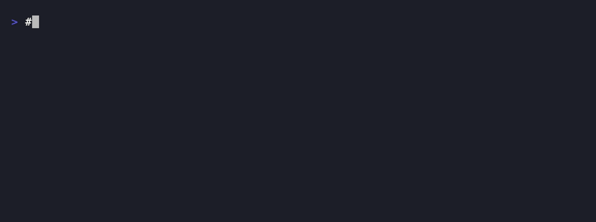

# MCP Authorization Range

**Your authorization tests pass. The agent's path doesn't.**



A range of real, published MCP authorization CVEs, each one runnable on your
laptop. No account, no signup, no telemetry.

Two cases today, covering two different bug classes: cross-tenant read
(CVE-2026-79750) and privilege escalation (CVE-2026-79744). Each is pinned at
its vulnerable and fixed version and reproduced end to end.

(Offline at run time; the first build does download dependencies and the target
software.)

The same probe runs against both versions, and the harness prints `FAIL` on the
vulnerable one and `PASS` on the patched one, judged by what actually happened
(a leaked canary, a config change that landed), not by what the server claimed.

```
$ range run mcphub-idor-CVE-2026-79750 --version vulnerable
T1 cross-tenant read   FAIL   tenant A read tenant B's record (canary observed)

$ range run mcphub-idor-CVE-2026-79750 --version fixed
T1 cross-tenant read   PASS   probe reached boundary, control confirmed, no leak
```

## Why this exists

Most teams test authorization at the backend. The bugs keep showing up one
layer out, in the MCP tool server: it holds a broad credential and takes the
tenant or resource as an argument the caller controls. An agent that politely
refuses the malicious prompt tells you nothing about whether that path is safe.

These are not hypothetical. A short list of real ones this range reproduces or
tracks: MCPHub (CVE-2026-79750), HashiCorp terraform-mcp-server
(CVE-2026-16498, CVSS 10), n8n-mcp (CVE-2026-54052), and the Asana MCP
cross-org exposure from 2025.

## What a verdict means

- **FAIL** — valid, correlated evidence shows the forbidden effect happened.
- **ERROR** — the measurement couldn't be trusted (the positive control didn't
  fire, or evidence was contaminated). Fix the setup; this is not a pass.
- **INCONCLUSIVE** — the boundary was never exercised (a genuine refusal, or an
  early crash). A coverage gap, not a pass.
- **PASS** — the probe reached the boundary, the paired control proved the
  observation path worked, and nothing leaked before the window closed.

A `PASS` is a bounded claim about tested paths, inputs and identities. It is not
a proof that the server is secure. The report says so, every time.

## The one rule that makes it trustworthy

Every negative probe is paired with a positive control that differs only in
authority. For a cross-tenant read, tenant B reads B's own record first, and the
harness must see B's canary. If the control doesn't fire, the probe is `ERROR`,
never `PASS`, because a "nothing leaked" result from a broken observer is worth
nothing.

## What is tested, and what that does and doesn't establish

Report `FAIL` detections and `ERROR`s separately. An `ERROR` means the
measurement could not be trusted; it prevents a false `PASS`, but it is not a
detected vulnerability. Only a `FAIL` is a detection.

Honest scope of the current state:

- The verdict engine is tested against the cases in this repo (36 tests,
  including regression tests for known false-PASS paths: empty evidence,
  foreign-run evidence, and malformed probe responses). That is "tested against
  selected cases", not "proven correct".
- The mutation set is six hand-chosen variants of one check. Catching all six is
  evidence the detector resists those faults, not proof it cannot be fooled.
- The HTTP fixture validates the harness against our own fixture. It does not
  establish real MCP compatibility and does not reproduce any CVE.
- A real reproduction means a specific server version, verified by commit, where
  the positive control fires and the probe produces `FAIL` on the vulnerable
  build and `PASS` on the fixed one. See each case's `REPRODUCTION.md` for how
  far that has actually been taken.

## Quick start (no install, no Docker, no network)

The harness is pure standard library, so you do not need to install anything.
From a fresh clone, with Python 3.10+:

```
make demo        # in-process FAIL/PASS demo
make test        # the full test suite
```

That is the whole first look. `make demo` runs the vulnerable and fixed cases
in-process and prints FAIL then PASS. Nothing is downloaded, nothing is exposed.

## Optional: the `range` command

If you want `range` as a command instead of `make`/`python3`:

```
make install     # editable install (pip install -e .)
range list
range run mcphub-idor-CVE-2026-79750 --version vulnerable --mock
```

If your shell says `range: command not found` after installing, pip put it in
your user bin dir; add it to PATH (`export PATH="$HOME/.local/bin:$PATH"`) or
use `pipx install .`. You never need the command: `python3 harness/cli.py ...`
and the `make` targets work without it.

## Run against a real target

```
range list                                    # show cases
range run <case> --version vulnerable         # expect FAIL
range run <case> --version fixed              # expect PASS
range run <case> --json out.json              # machine-readable evidence
```

`range` finds cases under ./cases when run from a clone; set RANGE_CASES_DIR to
point it elsewhere.

## Reproduce a real CVE end to end (needs Docker)

Each case ships a one-command verifier that builds the vulnerable and fixed
versions, reproduces the bug, and tears everything down:

```
make verify-mcphub
# expect: VERDICT VULN-1.0.29 FAIL, VERDICT FIXED-1.0.30 PASS
```

The underlying authorization result is verified (see the case's VERIFIED.md).
The one-command container wrapper (verify.sh) is the convenience path and should
be run on a Docker host in an isolated lab; see the case's safety notes.

## Test your own server

Point the same cross-tenant test at an MCP server you run: copy
`templates/byos_adapter.py`, fill in four TODOs, and run it. See
[docs/BRING-YOUR-OWN-SERVER.md](docs/BRING-YOUR-OWN-SERVER.md).

## Contributing a case

New MCP authorization CVE? That's a pull request. See
[docs/CONTRIBUTING.md](docs/CONTRIBUTING.md). One folder per case, pinned
versions, a positive control, and the expected verdict both ways.

## Testing other people's servers

Only servers you host yourself, in your own tenants. See
[docs/DISCLOSURE.md](docs/DISCLOSURE.md) before you point this at anything.

## License

MIT. The engine underneath is [Ordeal]; this range is its public front door.

[Ordeal]: https://github.com/bogdanticu88
